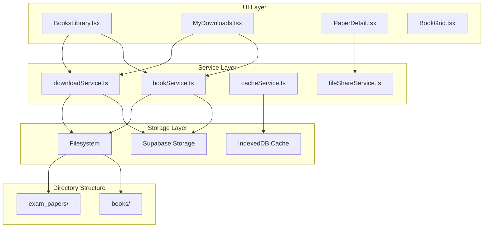

# Design Document: Downloadable Books and Enhanced Sharing

## Overview

This design extends the existing mobile app architecture to provide downloadable books functionality and enhanced paper sharing capabilities. The solution leverages the existing download infrastructure while adding book-specific components and improving the sharing mechanism to use actual files instead of deep links.

The design follows the established patterns in the codebase:
- Extends the existing `downloadService` for books
- Integrates books into the `MyDownloads` interface
- Modifies `BooksLibrary` to support download functionality
- Enhances `PaperDetail` share behavior to require downloads
- Maintains separate directory structure for organization

## Architecture

### High-Level Architecture



### Component Interactions

The architecture maintains separation of concerns while reusing existing infrastructure:

1. **BooksLibrary** manages book browsing and initiates downloads
2. **MyDownloads** displays both papers and books with unified management
3. **PaperDetail** conditionally shows share button based on download status
4. **downloadService** handles both papers and books with type-specific logic
5. **fileShareService** manages native file sharing for downloaded content

## Components and Interfaces

### Extended Download Service

The existing `downloadService` will be extended to handle books while maintaining backward compatibility:

```typescript
// Extended DownloadService interface
interface IDownloadService {
  // Existing paper methods
  downloadPaper(paper: ExamPaper, onProgress: (progress: DownloadProgress) => void): Promise<string>;
  deletePaper(paperId: string): Promise<void>;
  getDownloadedPapers(): Promise<DownloadedPaper[]>;
  
  // New book methods
  downloadBook(book: LibraryBook, onProgress: (progress: DownloadProgress) => void): Promise<string>;
  deleteBook(bookId: string): Promise<void>;
  getDownloadedBooks(): Promise<DownloadedBook[]>;
  
  // Unified methods
  getTotalStorageUsed(): Promise<number>;
  getAllDownloads(): Promise<(DownloadedPaper | DownloadedBook)[]>;
  deleteMultipleItems(items: Array<{id: string, type: 'paper' | 'book'}>): Promise<void>;
}
```

### Book Service

A new service to handle book-specific operations:

```typescript
interface IBookService {
  getBooks(filters?: BookFilterCriteria): Promise<LibraryBook[]>;
  getBook(bookId: string): Promise<LibraryBook | null>;
  searchBooks(query: string): Promise<LibraryBook[]>;
  incrementDownloadCount(bookId: string): Promise<void>;
}

interface BookFilterCriteria {
  category?: string;
  subject?: string;
  system?: string;
  classLevel?: string;
}
```

### File Share Service

A new service to handle native file sharing:

```typescript
interface IFileShareService {
  shareFile(filePath: string, title: string): Promise<void>;
  shareMultipleFiles(files: Array<{path: string, title: string}>): Promise<void>;
  canShare(): Promise<boolean>;
}
```

### Enhanced UI Components

#### Modified BooksLibrary Component

```typescript
interface BooksLibraryState {
  books: LibraryBook[];
  downloadStatuses: Map<string, DownloadStatus>;
  downloadProgresses: Map<string, DownloadProgress>;
  loading: boolean;
  error: string;
}

interface DownloadStatus {
  isDownloaded: boolean;
  isDownloading: boolean;
  localPath?: string;
}
```

#### Enhanced MyDownloads Component

```typescript
interface MyDownloadsState {
  downloadedPapers: CachedPaper[];
  downloadedBooks: CachedBook[];
  filterType: 'all' | 'papers' | 'books';
  selectedItems: Set<string>;
  itemTypes: Map<string, 'paper' | 'book'>;
}
```

#### Modified PaperDetail Component

```typescript
interface PaperDetailState {
  paper: ExamPaper | null;
  isDownloaded: boolean;
  showShareButton: boolean; // Only true when downloaded
  downloadProgress: DownloadProgress | null;
}
```

## Data Models

### Book Data Model

```typescript
interface LibraryBook {
  id: string;
  title: string;
  author: string | null;
  subject: string;
  category: string;
  system: string;
  class_level: string | null;
  description: string | null;
  cover_url: string | null;
  file_url: string;
  file_name: string;
  file_size: number;
  file_size_formatted: string;
  tags: string[];
  downloads: number;
  published_year: number | null;
  created_at: string;
}
```

### Cached Book Model

```typescript
interface CachedBook {
  id: string;
  title: string;
  author: string | null;
  subject: string;
  category: string;
  fileSize: number;
  fileSizeFormatted: string;
  tags: string[];
  downloads: number;
  isDownloaded: boolean;
  localPath?: string;
  downloadedAt?: string;
  lastFetched: string;
}
```

### Downloaded Book Model

```typescript
interface DownloadedBook {
  id: string;
  bookId: string;
  localPath: string;
  downloadedAt: string;
  fileSize: number;
  title: string;
  author: string | null;
  subject: string;
  category: string;
}
```

### Unified Download Progress

```typescript
interface DownloadProgress {
  itemId: string;
  itemType: 'paper' | 'book';
  progress: number;
  bytesDownloaded: number;
  totalBytes: number;
  status: 'downloading' | 'completed' | 'failed' | 'cancelled';
}
```

## File System Organization

### Directory Structure

```
app_data/
├── exam_papers/          # Existing papers directory
│   ├── paper_1.pdf
│   ├── paper_2.pdf
│   └── ...
└── books/               # New books directory
    ├── book_1.pdf
    ├── book_2.pdf
    └── ...
```

### File Naming Convention

Books will follow a consistent naming pattern:
- Format: `{sanitized_title}_{book_id}.pdf`
- Example: `Advanced_Mathematics_Textbook_abc123.pdf`

### Storage Constants

```typescript
// Extended filesystem constants
export const EXAM_PAPERS_DIR = 'exam_papers';
export const BOOKS_DIR = 'books';
export const BASE_DATA_DIR = 'app_data';

export const STORAGE_PATHS = {
  PAPERS: `${BASE_DATA_DIR}/${EXAM_PAPERS_DIR}`,
  BOOKS: `${BASE_DATA_DIR}/${BOOKS_DIR}`
} as const;
```

## Implementation Strategy

### Phase 1: Core Infrastructure

1. **Extend downloadService**
   - Add book download methods
   - Implement books directory management
   - Add unified storage calculation

2. **Create bookService**
   - Implement book fetching and caching
   - Add book-specific metadata handling

3. **Create fileShareService**
   - Implement native file sharing
   - Add multi-file sharing support

### Phase 2: UI Integration

1. **Modify BooksLibrary**
   - Add download buttons to book cards
   - Implement download progress indicators
   - Add download status management

2. **Enhance MyDownloads**
   - Add books section with filtering
   - Implement unified selection and actions
   - Add book-specific metadata display

3. **Update PaperDetail**
   - Conditionally show share button
   - Implement file-based sharing

### Phase 3: Advanced Features

1. **Bulk Operations**
   - Multi-select for books and papers
   - Bulk download, delete, and share

2. **Offline Synchronization**
   - Sync download status across devices
   - Handle offline state management

3. **Storage Management**
   - Advanced cleanup options
   - Storage usage analytics

## Testing Strategy

### Unit Testing

**Core Services Testing:**
- downloadService book methods with mocked filesystem operations
- bookService data fetching and caching logic
- fileShareService sharing capabilities with mocked Capacitor APIs

**Component Testing:**
- BooksLibrary download functionality with mocked services
- MyDownloads book integration with test data
- PaperDetail conditional share button behavior

**Integration Testing:**
- End-to-end book download workflow
- File sharing integration with native capabilities
- Storage management across papers and books

### Property-Based Testing

Property-based testing is not applicable to this feature as it primarily involves:
- UI rendering and user interactions
- File system operations and native API integrations
- Configuration and state management

These areas are better served by example-based unit tests, integration tests, and manual testing of the user interface.

## Error Handling

### Download Error Scenarios

1. **Insufficient Storage**
   - Check available space before download
   - Display clear error with required space information
   - Suggest cleanup options

2. **Network Connectivity Issues**
   - Implement download pause/resume functionality
   - Show appropriate offline indicators
   - Queue downloads for when connectivity returns

3. **File Corruption**
   - Validate downloaded files
   - Automatic retry with exponential backoff
   - Clear error messages for user action

### Sharing Error Scenarios

1. **File Not Found**
   - Verify file existence before sharing
   - Offer re-download option
   - Clear error messaging

2. **Platform Limitations**
   - Graceful fallback for unsupported platforms
   - Alternative sharing methods (copy link)
   - User-friendly error messages

### Storage Error Scenarios

1. **Directory Creation Failures**
   - Retry with exponential backoff
   - Fallback to alternative storage locations
   - Clear error reporting

2. **Permission Issues**
   - Request necessary permissions
   - Provide clear instructions to user
   - Graceful degradation of functionality

## Performance Considerations

### Download Optimization

1. **Concurrent Downloads**
   - Limit simultaneous downloads (max 3)
   - Queue management for multiple requests
   - Progress tracking for each download

2. **Memory Management**
   - Stream large files to avoid memory issues
   - Cleanup temporary data promptly
   - Monitor memory usage during downloads

3. **Caching Strategy**
   - Cache book metadata separately from papers
   - Implement intelligent cache eviction
   - Optimize cache lookup performance

### UI Performance

1. **List Virtualization**
   - Implement virtual scrolling for large lists
   - Lazy loading of book thumbnails
   - Efficient re-rendering strategies

2. **State Management**
   - Minimize unnecessary re-renders
   - Optimize state updates for download progress
   - Efficient filtering and search operations

## Security Considerations

### File Access Control

1. **Sandboxed Storage**
   - Use Capacitor's secure filesystem APIs
   - Prevent unauthorized file access
   - Validate file paths and names

2. **Download Validation**
   - Verify file integrity after download
   - Validate file types and sizes
   - Sanitize file names to prevent path traversal

### Sharing Security

1. **File Sharing Permissions**
   - Use native sharing APIs only
   - Respect platform sharing restrictions
   - No direct file system access to other apps

2. **Data Privacy**
   - Share only explicitly selected files
   - Clear user consent for sharing actions
   - No automatic or background sharing

## Migration Strategy

### Backward Compatibility

1. **Existing Downloads**
   - Maintain compatibility with existing paper downloads
   - No changes to existing file locations
   - Preserve existing cache data

2. **API Compatibility**
   - Extend existing interfaces without breaking changes
   - Maintain existing method signatures
   - Add new methods with clear naming conventions

### Data Migration

1. **Cache Updates**
   - Extend existing cache schema for books
   - Migrate existing data structures
   - Handle version compatibility

2. **Storage Structure**
   - Create new books directory without affecting papers
   - Implement gradual migration if needed
   - Maintain data integrity during updates

## Monitoring and Analytics

### Download Metrics

1. **Success Rates**
   - Track download completion rates for books vs papers
   - Monitor failure reasons and frequencies
   - Measure retry success rates

2. **Performance Metrics**
   - Download speed and duration tracking
   - Storage usage patterns
   - User engagement with downloaded content

### Usage Analytics

1. **Feature Adoption**
   - Track book download feature usage
   - Monitor sharing behavior changes
   - Measure user satisfaction with new features

2. **Storage Analytics**
   - Monitor storage usage patterns
   - Track cleanup and deletion behaviors
   - Optimize storage recommendations

This design provides a comprehensive foundation for implementing downloadable books and enhanced sharing while maintaining the existing architecture's integrity and performance characteristics.