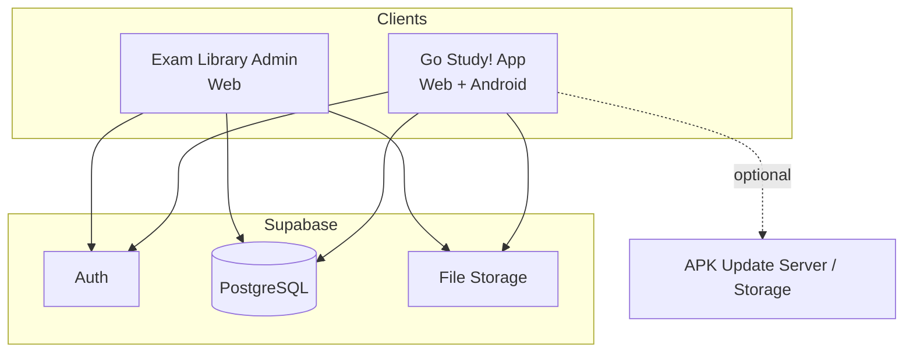

# Grade Goal — Full Application Overview

**Grade Goal** (branded in the UI as **Go Study!**, with internal/package names like **ScoreTarget**) is a student grade-tracking and study platform aimed at Francophone African and Nigerian university students. It combines a **grade planner**, **what-if simulator**, **exam paper & book library**, **courses catalog**, and **premium subscription** mechanics, backed by **Supabase** and shipped as a **web app + Android APK** via Capacitor.

---

## What it is at a glance

| Layer | Role |
|--------|------|
| **Main app** (`src/`, port 8080) | Student-facing PWA/mobile app: track grades, plan targets, browse/download PDFs, take courses links, give feedback |
| **Admin panel** (`exam-library-admin/`, port 5173) | Internal **Exam Library Admin** for content, notifications, subscriptions, and app releases |
| **Backend** | Supabase (auth, PostgreSQL, storage) + optional Node routes for APK updates |

---

## Main student app

### Authentication & onboarding

- **Welcome** (`/welcome`): language toggle (French/English), sign-in or **guest** mode.
- **Auth** (`/auth`, OAuth callback): Supabase auth; data can sync to cloud (`user_profile`, `user_app_state`).
- **Onboarding** (`/onboarding`, also `/planner`): multi-step setup:
  - Choose **grading system** (APC, French, or Nigerian university)
  - Profile (name, class level, série, semester, department, etc.)
  - Set **target average** (e.g. /20 for APC/French, CGPA scale for Nigerian)
  - Add **subjects** and enter **marks**

Protected routes require login + completed onboarding.

---

### Three grading systems (core differentiator)

The app adapts its entire UI and math based on `gradingSystem`:

| System | Typical users | Mark model | Averages |
|--------|---------------|------------|----------|
| **APC** (Cameroon) | Lycée / secondary | **Interro**, **Devoir**, **Composition** per subject, with coefficients | Classwork average + compo (optional 40/60 split); yearly average weighted by coefficient |
| **French** | French-style schools | Same three mark types + optional **class average**, min/max, **appreciation** (1–5) | Student vs class comparison, percentiles, French summary views |
| **Nigerian university** | University | **Credit units**, scores 0–100, **custom weighted assessments** | GPA/CGPA, letter grades, degree classification (First Class, etc.) |

**Settings** let users tune mark weights (interro/dev/compo), rounding mode, color thresholds for "on track" alerts, and APC 40/60 split.

---

### Home dashboard (`/`)

The main hub after onboarding:

- **Current average** vs **target**, progress visuals, mascot/UI polish
- **Per-subject breakdown** (marks, coefficients, averages)
- **Performance alerts** (subjects below target, unreachable goals)
- **Streak** and **mark history** (log of past entries, filterable)
- **Semester management** (APC/French: multiple semesters; Nigerian: semester GPA/CGPA)
- **Admin push notifications** (bell sheet; targeted by grading system)
- **Onboarding checklist** and **product tour** for new users
- Links to **library**, **simulator**, **profile**, **settings**, **feedback**
- **Premium upsell** sheets (when enabled remotely)

---

### Grade simulator (`/simulator`)

"What-if" tool:

- Sliders for **missing** interro/dev/compo marks
- Live **simulated yearly average** vs target
- **Save strategies** (planned marks to hit a goal)
- Premium nudges on certain actions (when premium is on)

---

### Planner / marks entry (`/planner`, `/onboarding`)

- Add/edit subjects and enter marks
- Separate flows for **Nigerian** vs APC/French mark inputs
- State persisted in `localStorage` (`scoretarget_state`) and optionally synced to Supabase

---

### Profile (`/profile`)

- Edit student info, class level, série, target
- Manage **subjects** (add/remove, search preset subject lists by level)
- **Multi-semester archive** (APC/French and Nigerian)
- Nigerian: **CGPA**, classification, credit-unit tracking
- Premium subscription UI (plans, subject packs, payment sheet)
- Developer-only extras for a configured admin email

---

### Exam library (`/library`, `/library/papers`, `/library/books`)

**Exam papers**

- Browse Supabase-backed **exam papers** (PDFs): filter by class level, subject, year, exam type (Baccalauréat, Composition, Devoir, Interro, etc.)
- Cameroon/French class levels from **6ème** through **Tle** with série variants
- **Search**, grid/list views, preview
- **Download** for offline use; download counts tracked
- **In-app PDF viewer**
- Caching via IndexedDB (`cacheService`)

**Books** (`/library/books`)

- Separate **library books** catalog
- Download, offline open, **share** files (native share on mobile)
- Book detail page (`/book/:bookId`)

**My downloads** (`/my-downloads`)

- All offline papers and books
- Storage usage, delete, multi-select, re-download from cloud
- Share exported PDFs

**Subject dashboard** (`/subject/:subjectName`)

- **Study prep / premium tools** per subject (when content exists):
  - Top questions, key topics, cheat sheet, step-by-step solutions, practice tests, weak spots
- Often gated behind premium subscription

---

### Courses (`/courses`)

- Catalog of **course posts** from Supabase (`course_posts`)
- Filter by category (Math, Science, Languages, etc.) and level
- Featured courses, external **link_url** to enroll/view
- View tracking per user

---

### Feedback board (`/feedback`)

- Students submit **feature requests / ideas**
- **Upvote** others' items
- Status labels: Under review → Planned → In progress → Completed
- Users can delete their own posts

---

### Settings (`/settings`)

- Theme: light / dark / system + **accent colors**
- Language: **French / English**
- Grading weights, rounding, notification preferences
- Sign out, wipe local data & downloads
- Account email display

---

### Other pages

- **Privacy** & **Terms** (public legal)
- **Debug** / **Fix state** (dev utilities)
- **Splash screen** on native launch
- **App update dialog**: checks for newer **APK** versions (Android), download & install via custom Capacitor plugin

---

### Mobile / native (Android)

Built with **Capacitor**:

- Filesystem storage for downloads
- Haptics, status bar, splash screen, screen orientation
- Share, file opener, local notifications
- **APK sideload updates** (admin uploads APK; app prompts users)
- Package id: `com.scoretarget` (ScoreTarget)

Works as a **responsive web app** in the browser too.

---

### Premium & subscriptions (optional)

Controlled by:

- Local flag `PREMIUM_ENABLED` (currently **false** → full free behavior)
- Remote `app_config.premium_enabled` from Supabase (admin toggle)

When enabled:

- Subscription **codes** (redeem in app)
- Plans, subject packs, payment sheets
- Locked previews for library prep tools
- Admin generates/prints codes

---

### Data & sync

- Primary state: **localStorage** + optional **Supabase** hybrid sync on login
- Library metadata in Supabase; files in **storage buckets**
- Offline-first for downloaded PDFs

---

## Admin panel (Exam Library Admin)

Login required (Supabase admin users). Sidebar sections:

### Dashboard (`/`)

- Total papers, total downloads, storage used, today's downloads
- Recent uploads list
- Storage quota indicator (~1 GB)

### Upload (`/upload`)

Three tabs:

1. **Mass upload** – batch exam PDFs with metadata
2. **Single paper** – one exam at a time
3. **Books** – upload library books (PDF + metadata)

### Papers (`/papers`)

- Table of all exam papers
- **Edit** metadata, **delete** papers (and storage)

### Courses (`/courses`)

- CRUD for **course posts**: title, description, instructor, price, duration, level, category, image, external link, featured flag, active/inactive, expiry

### Analytics (`/analytics`)

- Download analytics, storage stats, bandwidth usage
- Top papers by downloads, per-subject breakdown

### Notifications (`/notifications`)

- Create **push-style in-app notifications** for students
- Target: **all**, **APC**, **French**, or **Nigerian** users
- Title, body, icon, optional **image**, action URL, expiry
- List and delete sent notifications

### Feedback (`/feedback`)

- Moderate student feedback board
- Change status, filter by grading system, delete items
- See vote counts

### App Updates (`/app-updates`)

- Upload **APK** builds (version name/code, release notes, bug fixes, features)
- Mandatory update flag, min supported version
- Publish/hide/delete update records
- Students get update prompts in the main app

### Subscription codes (`/subscription-codes`)

- **Generate** premium codes in bulk
- Stats cards (usage, active, etc.)
- **Printable CSV/sheet** for physical distribution
- Codes table with redemption status

### App settings (`/app-settings`)

- **Toggle premium features** globally (`premium_enabled` in `app_config`)

### Debug (`/debug`)

- Internal diagnostics (admin-only tooling)

---

## Architecture summary

---

## What students can do (checklist)

1. Sign up / guest / sync grades across devices
2. Track grades in APC, French, or Nigerian university systems
3. Set targets and see if they're on track
4. Simulate future marks to hit goals
5. Browse, download, and read exam PDFs and books offline
6. Share downloaded files on mobile
7. Browse recommended external courses
8. Vote on and submit product feedback
9. Receive admin announcements
10. Update the Android app when admins publish a new APK

## What admins can do (checklist)

1. Upload and manage exam papers and books
2. Manage course catalog entries
3. View download/storage analytics
4. Send targeted notifications
5. Moderate feedback and roadmap statuses
6. Publish APK updates
7. Generate and print premium subscription codes
8. Enable/disable premium paywall globally

---

*Document generated from Grade Goal / Go Study! codebase overview.*
